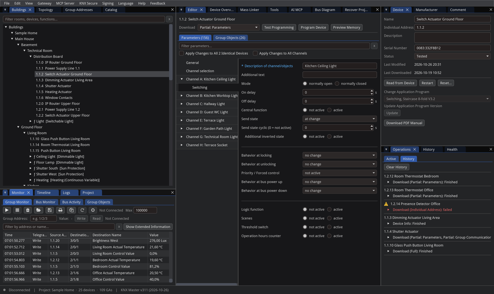
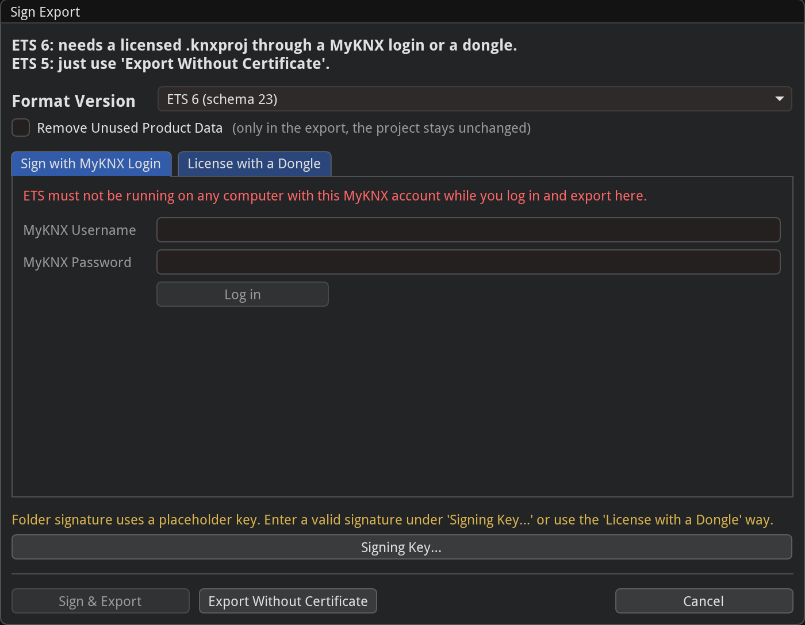
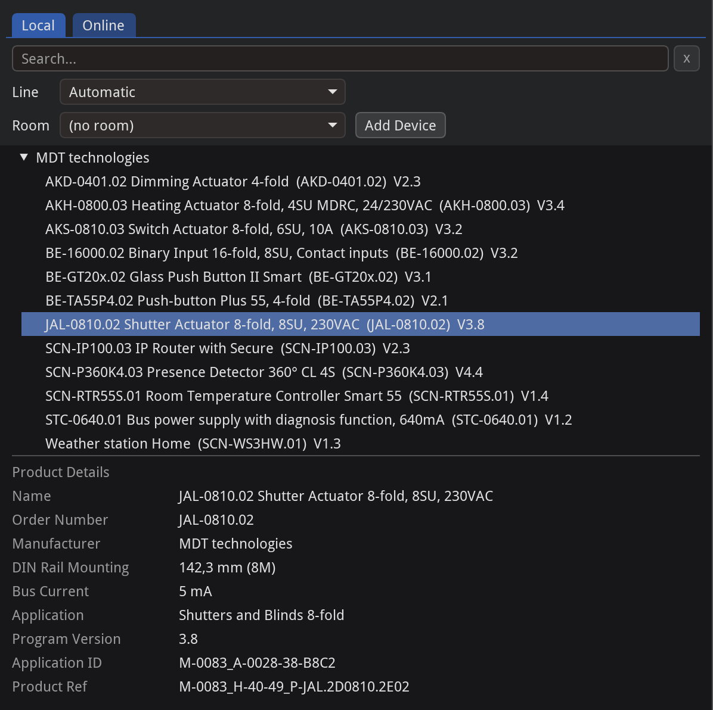
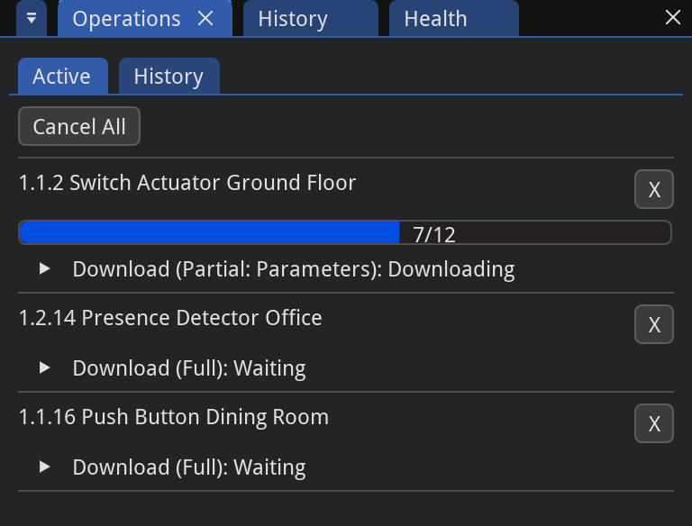
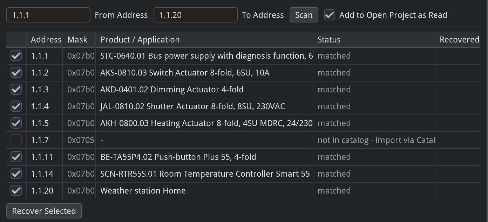
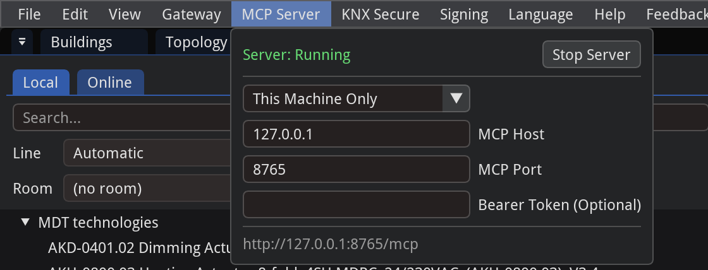

# XKNX Editor


XKNX Editor is a **multi-platform** desktop app (Windows, Linux, macOS) with native AI support for KNX building-automation projects based on KNX Standard Vol. 3, built on the open-source [xknx](https://github.com/XKNX/xknx)
library. Import and export `.knxproj` projects natively by [XKNXProject](https://github.com/XKNX/xknxproject) and [OpenKNXProducer](https://github.com/OpenKNX/OpenKNXproducer), browse product catalogs, **program KNX
devices** over a real bus based on [XKNX Project XKNXToolkit](https://github.com/XKNX/xknxtoolkit), and drive it all through an **integrated MCP server for AI-assisted**
workflows which can auto-download PDF manuals from the manufacturers.


> [!WARNING]
> **Not affiliated with the KNX Association.** See
> [Disclaimer](#disclaimer) and [Purpose](#purpose-and-interoperability)
>
>XKNX Editor comes with no  guarantees. It is tested with real devices but still a download can leave a device unavailable until it
> is reprogrammed. Do not use it on a installation you cannot access directly and
> keep a ETS backup of any project before opening it here.
>
> Verified device coverage for downloading is good but not complete. Please report if you have issues with a device.

## Download

Prebuilt apps for **Windows, Linux, and macOS** are attached to every release — grab the latest from
the [Releases page](https://github.com/xknx/xknx-editor/releases/latest) and start it directly.

On Windows, run `XKNX-Editor-windows-installer-x64.exe` (or `-arm64.exe` on Windows on ARM). It
installs for the current user without administrator rights, adds a Start menu entry (and one for
the [browser UI](#browser-ui)), a desktop shortcut and the `.xknx` file association (optionally also `.knxproj`, opened as an import), and
can be removed in Apps & Features. In a virtual
machine without a graphics driver, select "Software rendering" in the installer. The
`XKNX-Editor-windows-portable-*.zip` archives run without installation.

On macOS the app is not signed by Apple yet, so the first launch is blocked:


To allow it, open it once, then go to **System Settings → Privacy & Security**, scroll down, and
click **Open Anyway** (confirm on the next launch). Alternatively, remove the quarantine flag in a
terminal:

```bash
xattr -dr com.apple.quarantine "/Applications/XKNX Editor.app"
```

On Linux, make the AppImage executable first (a double-click without this may open it in a
disk-image tool instead of launching):

```bash
chmod +x XKNX-Editor-x86_64.AppImage && ./XKNX-Editor-x86_64.AppImage
```

## Reporting problems

Report a problem via **Feedback** in the menu bar, which opens the
[issues page](https://github.com/xknx/xknx-editor/issues), and attach the log of the run in which
it happened. **Help → Open Log Folder** opens the folder: every run writes its own
`xknx-editor_<date>_<time>_<process>.log`, and the last 10 runs are kept. The folder is
`%LOCALAPPDATA%\xknx-editor\xknx-editor\Logs` on Windows, `~/Library/Logs/xknx-editor` on macOS
and `~/.local/state/xknx-editor/log` on Linux.

## Features

<!-- Images are placeholders — replace the files in docs/images/ with real screenshots. -->

**Project editor** — a tree for the installation (topology, group addresses, buildings and rooms), a
detail table, and a properties panel. Communication objects are linked to group addresses with live
compatibility checks, and every change has full undo/redo.



**Import and export both work.** Open an existing project file and edit it, or export one that opens
in ETS. Exports bundle the required product data so the project is self-contained, are signed so ETS
accepts them. Based on [XKNXProject](https://github.com/XKNX/xknxproject) and [OpenKNXproducer](https://github.com/OpenKNX/OpenKNXproducer)

The **Open Project** dialog accepts three formats and routes each automatically: an XKNX project
(`.xknx`), an ETS project archive (`.knxproj`, imported into a new project), and an ETS group-address
export (`.xml`, `ga-export/01`). A group-address export carries only the group-address tree (main and
middle group folders with their addresses and datapoint types, no devices); it is imported into a new
project whose group-address tree mirrors the export.



**Product catalog** — import product files into a searchable catalog of manufacturers, hardware, and
applications, independent of any project, and drag entries in as new devices. You can also browse the
online catalog, cached locally for offline use.



**Programming real devices** — commission a device end-to-end over a live connection (tunneling or
routing, with gateway discovery), including setting a new device's address. A read-only **preflight**
and **Test Programming** read the device back and show the exact changes before anything is
written. Vendor-independent by design.



**Cockpit and health checks** — a site-wide device table with live status, plus a panel that flags
issues (missing or duplicate addresses, applications missing from the catalog, unlinked objects,
group addresses without a type or sender); click a finding to jump to the device.


**Bus monitors and logs** — record and inspect bus traffic in the Group Monitor, Bus Monitor and Bus
Activity alongside a filterable application log;
with a project open, values are shown with the group address' name and decoded type.


**Recover from the bus** — reconstruct an installation without a project file by scanning an address
range and reading each device back read-only, then adding it to the project. Uncertain values are
marked rather than guessed, and a read-only verify diffs the result against the device. Still
maturing — review a recovered project before relying on it.



**MCP server (LLM control)** — an embedded [Model Context Protocol](https://modelcontextprotocol.io)
server lets an LLM drive the editor in the same live session as the GUI (shared project, catalog, and
connection). Start it from **Settings → MCP**. It can edit the project and program hardware, so only
expose it to clients you trust.



## Browser UI

The editor can also run without a window and be used in a web browser: on the same computer, or on
a server next to the installation (a mini PC, a NAS, a container) that you reach from the house
network. It is the same editor with the same dialogs; the browser draws it itself (no video
stream), so it stays sharp at any display scaling. Works in current Chrome, Edge, Opera, Firefox and
Safari (WebGL 2).

Start the app with `--web` and open the address it prints:

| | Command |
|---|---|
| Windows | `XKNX-Editor.exe --web`, or the Start menu entry **XKNX Editor (Browser)** |
| macOS | `/Applications/XKNX-Editor.app/Contents/MacOS/XKNX-Editor --web` |
| Linux | `./XKNX-Editor-x86_64.AppImage --web` |
| From source | `uv run python -m editor_gui.main --web` |

By default it serves `http://localhost:8080/` on this computer only (the next free port when 8080
is in use) and opens the default browser there. No sign-in is needed then. **File → Exit** in the browser, or Ctrl+C in the terminal it was
started from, ends it. A project file can be given as usual, e.g. `XKNX-Editor.exe --web Haus.xknx`.

Reachable from other devices, every browser signs in once with a password you choose:

```bash
XKNX_WEB_PASSWORD='choose a password' ./XKNX-Editor-x86_64.AppImage --web=0.0.0.0:8080
```

A network address given without a password works too, e.g. in a network protected otherwise; the app
then warns in its terminal, as anyone reaching it could program the installation and read its KNX
Secure keys. Behind a proxy that signs users in itself (e.g. Home Assistant Ingress) and reaches the
app on this computer, add `--web-trust-proxy`. For HTTPS, pass a certificate or let a reverse proxy
in front handle it.

| Option | Meaning |
|---|---|
| `--web[=[host:]port]` | Serve the browser UI (default `127.0.0.1:8080`; a port given must be free) |
| `--web-password-file=FILE` | Sign-in password from the first line of `FILE` (or `XKNX_WEB_PASSWORD`) |
| `--web-trust-proxy` | A proxy in front signs users in; no password |
| `--web-files=DIR` | Folder for uploaded, saved and exported files (default: `files` in the app's data folder) |
| `--web-idle=MINUTES` | Control passes to another browser after this much inactivity (default 10) |
| `--web-cert=FILE`, `--web-key=FILE` | Serve HTTPS with this certificate and key |
| `--web-no-browser` | Do not open the browser at start (an autostart, a service) |

On a tablet or phone the layout follows the screen: from about 1000 pixels width the usual one,
below it the navigation above (or beside) the other panels, which share one section as tabs; it
changes when the device is turned. On a narrow screen the menus are in one **☰** menu, the parameter
editor shows its pages above the parameters with each label above its field, rows of buttons go on
in the next line and wide tables scroll sideways. Each browser keeps its own zoom: two fingers,
Ctrl+Plus/Minus/0, Ctrl+wheel (a touchpad's pinch), or **View → Zoom In/Zoom Out/Reset Zoom**;
on the Topology diagram they zoom the diagram. With a finger, a tap clicks, a swipe scrolls, holding and lifting is a
right-click (context menus) and holding and moving drags. The on-screen keyboard appears for text
fields only.

One browser controls the editor at a time; it keeps control across a reload. Another browser watches
and can take over with **Take Control**, and gets control right away once the controlling one was
inactive for the idle time.

Files go through the browser: **Open** uploads a file from your computer (or drop it on the page)
or picks one already on the server; **Save** and **Export** write into the server's file folder and
download the result to your computer when **Download to This Computer** is ticked.

## Running from source

Only running from source is supported for now (developer-focused software).

```bash
uv sync
uv run python -m editor_gui.main
```

The app (distribution `xknxeditor-gui`, import package `editor_gui`) is a workspace member the root
project depends on, so a plain `uv sync` installs it and its `imgui-bundle` dependency.

## Packages

Standalone, typed Python libraries (the `xknxeditor` namespace), usable independently of the GUI:

| Package | Import | Description |
|---------|--------|-------------|
| `xknxeditor-namespaces` | `xknxeditor.namespaces` | XML schema bindings and version detection (foundation) |
| `xknxeditor-prod` | `xknxeditor.prod` | Reads and validates `.knxprod` product archives |
| `xknxeditor-catalog` | `xknxeditor.catalog` | Product catalog built from imported `.knxprod` archives |
| `xknxeditor-proj` | `xknxeditor.proj` | Project state management (incl. `.knxproj` import/export and offline signing) |
| `xknxeditor-datasecure` | `xknxeditor.datasecure` | Parses and serializes keyring XML (IP Secure keys) |
| `xknxeditor-download` | `xknxeditor.download` | Programs applications and individual addresses into real devices |
| `xknxeditor-recover` | `xknxeditor.recover` | Reconstructs a project by reading devices back from the bus |

## Development

```bash
uv sync                        # Install dependencies
uv run pytest                  # Run all tests (or: uv run pytest packages/namespaces)
uv run ruff check              # Lint
uv run pyright                 # Type check
```

See `CLAUDE.md` and `apps/editor-gui/CLAUDE.md` for architecture notes and conventions.

To test unreleased `xknx` changes, clone it as a sibling and add a `[tool.uv.sources]` override in
`apps/editor-gui/pyproject.toml` (`xknx = { path = "../../../xknx", editable = true }`), then
`uv lock`; revert both files before committing.

## Requirements

- Python >= 3.13
- [uv](https://docs.astral.sh/uv/)

## Purpose and interoperability

XKNX Editor is an independent, open-source tool that aims to improve interoperability within the KNX
ecosystem: reading, editing and exchanging KNX project data (`.knxproj`) and programming KNX devices
over the bus, without being tied to a single vendor's toolchain.

The project is guided by the principle — reflected in EU law — that interoperability between
independently created software should be possible (Directive 2009/24/EC on the legal protection of
computer programs, Article 6), and that a strong market position should not be used to foreclose
competition (Article 102 TFEU). XKNX Editor seeks to broaden choice and interoperability in KNX
tooling in that spirit.

This is a statement of the project's aims and not a legal determination about any third party.

## Disclaimer

An independent, open-source project built on the [xknx](https://github.com/XKNX/xknx) library. **Not
affiliated with, endorsed by, or connected to** the KNX Association or its ETS software. "KNX" and
"ETS" are trademarks of the KNX Association, used here only to state this non-affiliation and to
describe interoperability with the published standard and file formats.

## License

XKNX Editor is licensed under the **GNU General Public License v2.0 only** (`GPL-2.0-only`) — see
[LICENSE](LICENSE). Copyright (C) 2026 xknx

Based on [xknxtoolkit](https://github.com/XKNX/xknxtoolkit) by kewde.

The copyleft is inherited from [xknxproject](https://github.com/XKNX/xknxproject) (`GPL-2.0-only`),
used for `.knxproj` import: as a combined, distributed work XKNX Editor is therefore `GPL-2.0-only`.
Other bundled libraries are permissive (e.g. [xknx](https://github.com/XKNX/xknx), MIT).
