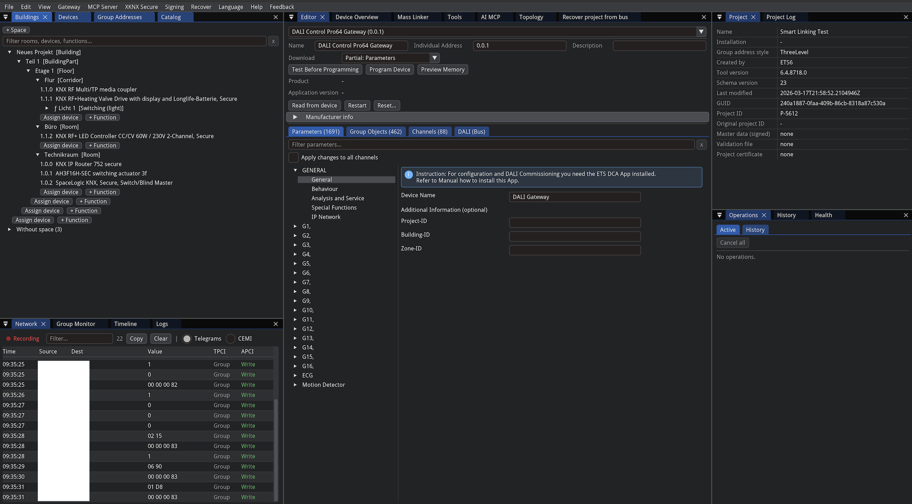
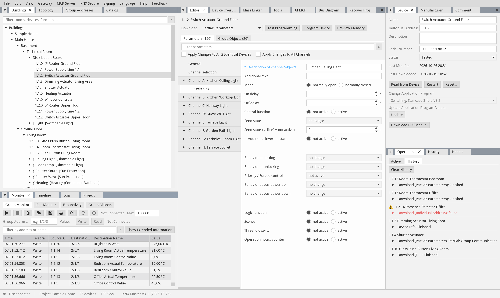
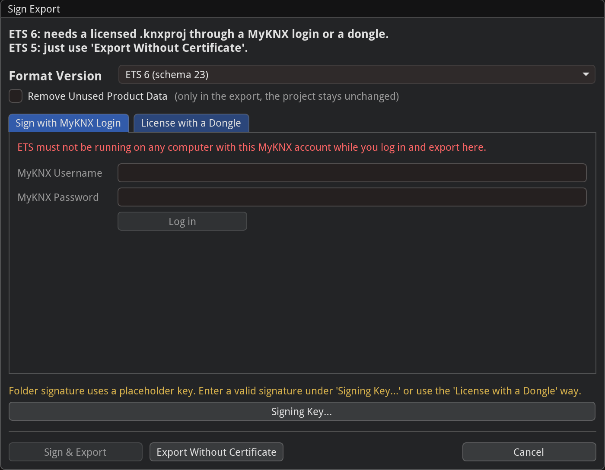
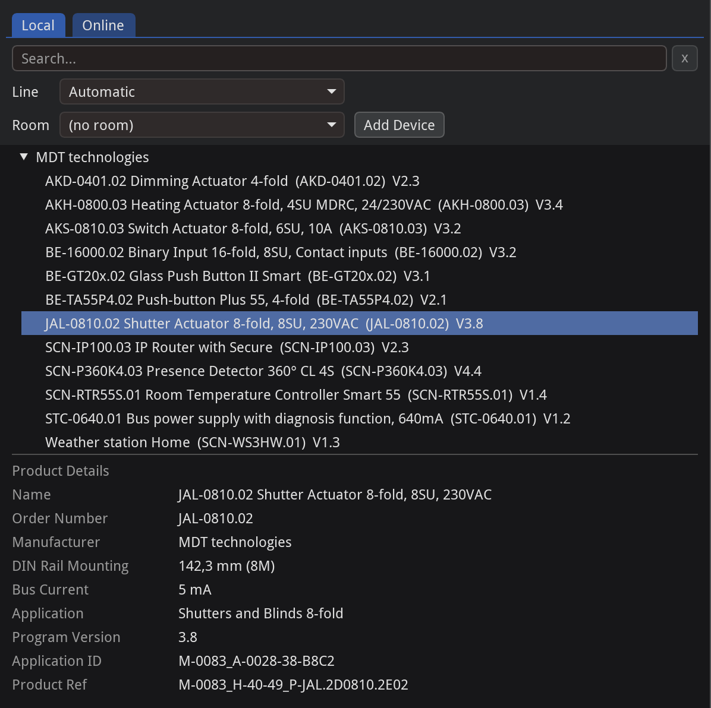
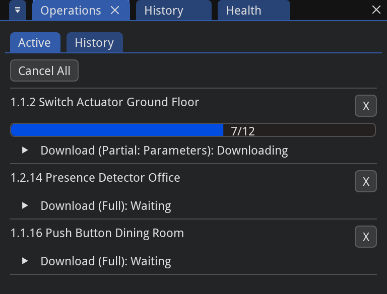
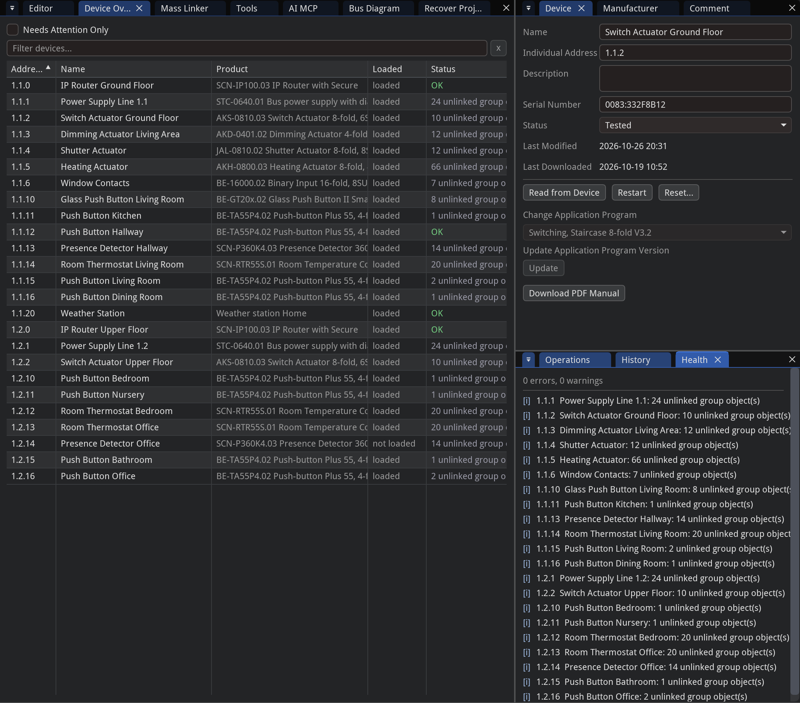
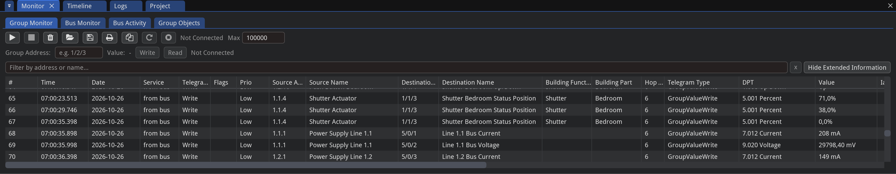
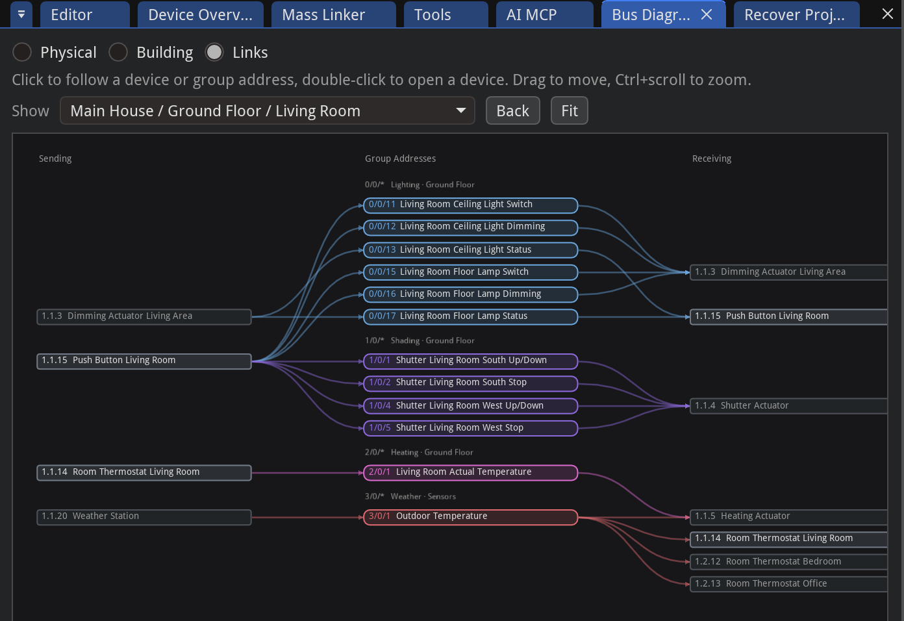
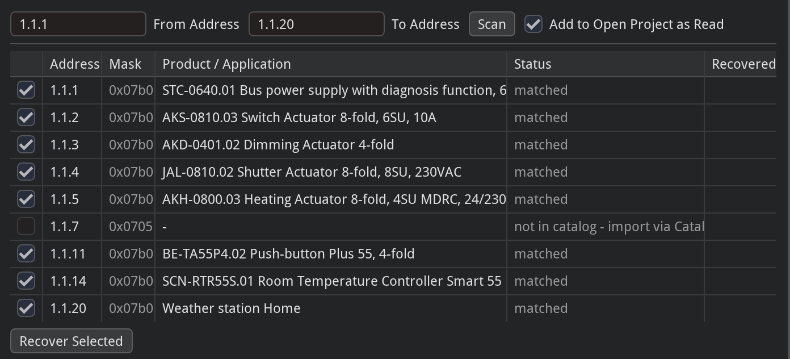
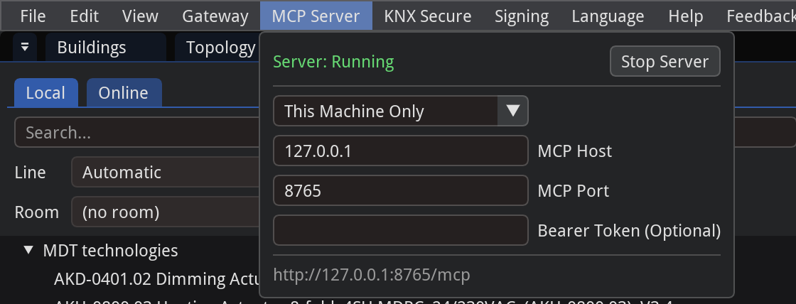

# XKNX Editor

XKNX Editor is a **multi-platform** desktop app (Windows, Linux, macOS) with native AI support for
KNX building-automation projects, based on KNX Standard Vol. 3. It builds on the open-source
[xknx](https://github.com/XKNX/xknx), [XKNXProject](https://github.com/XKNX/xknxproject),
[OpenKNXProducer](https://github.com/OpenKNX/OpenKNXproducer) and
[XKNXToolkit](https://github.com/XKNX/xknxtoolkit) libraries.

**What it does:**

- Import and export `.knxproj` projects, `.knxprod` and OpenKNX product files, and the older `.vd1`-`.vd5` product databases
- Program devices over a real KNX bus: System B, System 7, System 300 and BCU1, KNX Secure, more than 25 mask versions
- Recover a project straight from the bus, without a project file
- Integrated AI MCP server to organize a project, program devices and fetch device manuals
- DALI DCA support for DALI gateways (read, edit and commission over the bus), and displays that keep their setup in a blob (Busch-Jaeger Triton) with LVS `.prj` load and export
- Browser UI in Docker, with Unraid and TrueNAS templates
- Home Assistant integration: run it in the sidebar and work together with its KNX integration

> [!WARNING]
> **Not affiliated with the KNX Association.** See
> [Disclaimer](#disclaimer) and [Purpose](#purpose-and-interoperability)
>
>XKNX Editor comes with no  guarantees. It is tested with real devices but still a download can leave a device unavailable until it
> is reprogrammed. Do not use it on a installation you cannot access directly and
> keep a ETS backup of any project before opening it here.
>
> Verified device coverage for downloading is good but not complete. Please report if you have issues with a device.

## Download

Prebuilt apps for **Windows, Linux, and macOS** are attached to every release — grab the latest from
the [Releases page](https://github.com/xknx/xknx-editor/releases/latest) and start it directly, or
run it on a server via its [Browser UI](#browser-ui).

On Windows, run `XKNX-Editor-windows-installer-x64.exe` (or `-arm64.exe` on Windows on ARM). It
installs for the current user without administrator rights, adds a Start menu entry (and one for
the [browser UI](#browser-ui)), a desktop shortcut and the `.xknx` file association (optionally also `.knxproj`, opened as an import), and
can be removed in Apps & Features. In a virtual
machine without a graphics driver, select "Software rendering" in the installer. The
`XKNX-Editor-windows-portable-*.zip` archives run without installation.

On macOS the app is not signed by Apple yet, so the first launch is blocked:


To allow it, open it once, then go to **System Settings → Privacy & Security**, scroll down, and
click **Open Anyway** (confirm on the next launch). Alternatively, remove the quarantine flag in a
terminal:

```bash
xattr -dr com.apple.quarantine "/Applications/XKNX-Editor.app"
```

On Linux, make the AppImage executable first (a double-click without this may open it in a
disk-image tool instead of launching):

```bash
chmod +x XKNX-Editor-x86_64.AppImage && ./XKNX-Editor-x86_64.AppImage
```

The Linux desktop app needs `which` and a file-dialog program (`zenity`, `kdialog`,
`matedialog` or `qarma`). On Debian 13, install them with
`sudo apt install zenity gnu-which`, then restart the editor. If they are missing, a
window shows what to install. The browser UI needs neither program.

On Linux, a KNX USB interface is used through its `/dev/hidraw*` device, which only root may open
by default. A udev rule gives the logged-in user access to it; `lsusb` shows its vendor and product
id (here those of a SpaceLogic interface):

```bash
echo 'KERNEL=="hidraw*", ATTRS{idVendor}=="16de", ATTRS{idProduct}=="008e", TAG+="uaccess"' \
  | sudo tee /etc/udev/rules.d/70-knx-usb.rules
sudo udevadm control --reload && sudo udevadm trigger
```

On Windows and macOS KNX USB interfaces need no driver or setting.

Started while XKNX Editor already runs (as a window or as the browser UI), it asks whether to
switch to the running one, which then opens a project given at the start, or to start another, e.g.
for a second project or another bus connection. `--new-instance` starts another without asking.
Opening a project another XKNX Editor has open asks first as well.

## Reporting problems

Report a problem via **Help → Report a Bug**, which opens the
[issues page](https://github.com/xknx/xknx-editor/issues), and attach the log of the run in which
it happened. **Settings → Folders → Log Folder** opens the folder: every run writes its own
`xknx-editor_<date>_<time>_<process>.log`, and the last 10 runs are kept. The folder is
`%LOCALAPPDATA%\xknx-editor\xknx-editor\Logs` on Windows, `~/Library/Logs/xknx-editor` on macOS
and `~/.local/state/xknx-editor/log` on Linux.

## Features

**Project editor** — a tree for the installation (topology, group addresses, buildings and rooms), a
detail table, and a properties panel. Communication objects are linked to group addresses with live
compatibility checks, and every change has full undo/redo.



The same in the light theme:



**Import and export both work.** Open an existing project file and edit it, or export one that opens
in ETS. Exports bundle the required product data so the project is self-contained, are signed so ETS
accepts them. Based on [XKNXProject](https://github.com/XKNX/xknxproject) and [OpenKNXproducer](https://github.com/OpenKNX/OpenKNXproducer)

**A project file carries its product data.** An `.xknx` project stores the product data of each of its
devices, also of those added from the catalog. Opened on another computer, or in the editor inside
Home Assistant, the project imports the products that catalog lacks, so every device stays editable.
**Compact Project** removes the product data no device uses any more.

The **Open Project** dialog accepts three formats and routes each automatically: an XKNX project
(`.xknx`), an ETS project archive (`.knxproj`, imported into a new project), and an ETS group-address
export (`.xml`, `ga-export/01`). A group-address export carries only the group-address tree (main and
middle group folders with their addresses and datapoint types, no devices); it is imported into a new
project whose group-address tree mirrors the export.



**Product catalog** — import product files into a searchable catalog of manufacturers, hardware, and
applications, independent of any project, and drag entries in as new devices. You can also browse the
online catalog, cached locally for offline use.

The **Alternative** tab searches [KNX Product Search Database](https://reko.x3muha.de)
with full product metadata and imports `.knxprod` files into the local catalog. The index is
cached for offline search and checked hourly for updates. Login and registration are available
directly in the editor.



**Programming real devices** — commission a device end-to-end over a live connection (a KNX USB
interface, or tunneling or routing with gateway discovery), including setting a new device's address. A read-only **preflight**
and **Test Programming** read the device back and show the exact changes before anything is
written. Vendor-independent by design.



**DALI** — for DALI gateways (MDT, and the shared MDT/Theben/IPAS platform), read and edit the
gateway's DALI configuration — control gear, groups, scenes, time control and effects — in a table
view, and, over the bus, scan, address and commission the connected control gear from a **DALI
(Bus)** tab. Still maturing — verify against your own installation.

**Displays without parameters** — some devices, such as the Busch-Jaeger Triton, keep their
configuration in a blob instead of classic parameters. Configure them in the **Plugin Parameters**
panel, choose the display type, and load or export the display's LVS project (`.prj`).

**Cockpit and health checks** — a site-wide device table with live status, plus a panel that flags
issues (missing or duplicate addresses, applications missing from the catalog, unlinked objects,
group addresses without a type or sender); click a finding to jump to the device.

Devices with pending downloads have a download marker in the topology and building trees.
Hover or click it to see the missing parts. Health and the cockpit's needs-attention filter
show the same pending state, including flags imported with a project. MCP clients can use
`project_list_devices(download_pending_only=true)` or `project_health(category="download-pending")`.



**Bus monitors and logs** — record and inspect bus traffic in the Group Monitor, Bus Monitor and Bus
Activity alongside a filterable application log;
with a project open, values are shown with the group address' name and decoded type.



**Backups** — a backup of a project is one ZIP file with the complete project, made on request,
when the project is closed or at an interval, into a folder of your choice (a network drive or a
cloud folder keeps them off the computer). Compare a backup with the project in Project Diff, or
restore it; the state before a restore is kept as a backup too.

**Bus Diagram** — the installation drawn by its topology or by its buildings, and as links: which
devices send on each group address and which receive from it, for the whole project, a room, a
main group or one channel of a device. Click a device, channel or group address to follow it; the
arrow of a device lists its group objects under their channels.



**Recover from the bus** — reconstruct an installation without a project file by scanning an address
range and reading each device back read-only, then adding it to the project. Uncertain values are
marked, and a read-only verify diffs the result against the device. Settings
a device keeps no copy of are searched for; a device whose result still differs from what was read
is marked incomplete and can be searched again with more effort, without the bus. Still maturing —
review a recovered project before relying on it.



**MCP server (LLM control)** — an embedded [Model Context Protocol](https://modelcontextprotocol.io)
server lets an LLM drive the editor in the same live session as the GUI (shared project, catalog, and
connection). Start it from **Tools → MCP Server** (host, port, token and the commands that register
it in an AI tool are under **Settings → AI/MCP**), or with the editor through `--mcp` (see
[Started by another program](#started-by-another-program)). It can edit the project and program
hardware, so only expose it to clients you trust.



**Works with Home Assistant's KNX integration** — inside Home Assistant the open project becomes
the KNX project of its KNX integration. The editor sends the project over, turns the buildings into
Home Assistant's floors and areas and the building functions into entities (climate entities from
heating functions), hands over the time server and the project's keys, and takes Home Assistant's
floors, areas and group addresses back into the project. A group address shows what Home Assistant
does with it (an entity, an expose, the time server), and Home Assistant's telegrams appear in the
Group Monitor. A **Home Assistant** menu of its own collects it.

## Browser UI

The editor can also run without a window and be used in a web browser — on the same computer, or
on a server (mini PC, NAS, container) you reach from the house network. It is the same editor with
the same dialogs; the browser draws it itself (no video stream, so it stays sharp at any scaling).
Works in current Chrome, Edge, Opera, Firefox and Safari (WebGL 2).

Start the app with `--web` and open the address it prints:

| | Command |
|---|---|
| Windows | `XKNX-Editor.exe --web`, or the Start menu entry **XKNX Editor (Browser)** |
| macOS | `/Applications/XKNX-Editor.app/Contents/MacOS/XKNX-Editor --web` |
| Linux | `./XKNX-Editor-x86_64.AppImage --web` |
| From source | `uv run python -m editor_gui.main --web` |

By default it serves `http://localhost:8080/` on this computer only, opens the browser there (no
sign-in) and shows a tray icon with **Open in Browser** / **Stop XKNX Editor**. **Stop XKNX
Editor** or Ctrl+C ends it (the browser itself has no **File → Exit**). A project file can be given as usual, e.g. `XKNX-Editor.exe --web Haus.xknx`.

To reach it from other devices, give an address and a password (or `--web-trust-proxy` behind a
proxy that signs users in itself; for HTTPS pass a certificate or terminate TLS in the proxy):

```bash
XKNX_WEB_PASSWORD='choose a password' ./XKNX-Editor-x86_64.AppImage --web=0.0.0.0:8080
```

| Option | Meaning |
|---|---|
| `--web[=[host:]port]` | Serve the browser UI (default `127.0.0.1:8080`; a port given must be free) |
| `--web-password-file=FILE` | Sign-in password from the first line of `FILE` (or `XKNX_WEB_PASSWORD`) |
| `--web-trust-proxy` | A proxy in front signs users in; no password |
| `--web-proxy-ip=IP[,IP...]` | Answer only connections from these addresses (the proxy in front) |
| `--web-files=DIR` | Folder for uploaded, saved and exported files (default: `files` in the app's data folder) |
| `--web-idle=MINUTES` | Control passes to another browser after this much inactivity (default 10) |
| `--web-cert=FILE`, `--web-key=FILE` | Serve HTTPS with this certificate and key |
| `--web-no-browser` | Do not open the browser at start (an autostart, a service) |
| `--web-no-tray` | No tray icon |

`--help` lists all options.

### Started by Another Program

A program that starts the editor, like the Home Assistant integration, can set up its MCP server
and tell it that it runs inside Home Assistant:

| Option | Meaning |
|---|---|
| `--mcp=[host:]port` | Start the MCP server with the editor on this address (a port alone: `127.0.0.1`), with the bearer token from `XKNX_MCP_AUTH_TOKEN`; the editor then shows its status and address, not its settings |
| `--mcp-url=URL` | The address MCP clients use, shown in the editor (when a proxy is in front) |
| `--home-assistant` | Runs inside Home Assistant, started by its integration: Home Assistant updates the editor, so a new version is announced with its release notes and a hint to update the integration, not installed or downloaded |
| `--language=CODE` | The language of the program that starts the editor (e.g. `de`, `pt-BR`; the integration passes Home Assistant's): the editor's language, and with it the preferred product language, until one is chosen in the settings, in place of the system's; English if the editor lacks it |

Tablets and phones get a narrow layout (menus that do not fit in **☰**, parameter pages above the fields, button
rows wrap, wide tables scroll sideways); a tap clicks, hold+lift opens the context menu, hold+drag
drags. Each browser keeps its own zoom (two fingers, Ctrl+Plus/Minus/0, Ctrl+wheel, or
**View → Zoom**). One browser controls the editor at a time and keeps control across a reload;
another watches and can take over with **Take Control** (or automatically after the idle timeout).

Files go through the browser: **Open** uploads a file from your computer (or drop it on the page)
or picks one already on the server; **Save** and **Export** write into the server's file folder and
download the result to your computer when **Download to This Computer** is ticked.

### Container and Unraid

On a server, the browser UI runs without installing anything else:

| | |
|---|---|
| Docker, Compose, … | the image [`ghcr.io/xknx/xknx-editor-web`](https://github.com/XKNX/xknx-editor/pkgs/container/xknx-editor-web), built for every release (amd64, arm64); see [docker/README.md](docker/README.md) |
| Unraid | the template in [unraid](unraid), for Community Applications |

### Home Assistant

The [XKNX Editor integration](https://github.com/XKNX/xknx-editor-ha-integration) runs the editor
on your Home Assistant server and shows it in the sidebar, signed in with Home Assistant. It works
with Home Assistant OS and Home Assistant Container.

1. Open **Settings** > **Marketplace** in Home Assistant, search for **XKNX Editor** and install
   it. With Home Assistant 2026.10, which has no Marketplace yet, install it from
   [HACS](https://hacs.xyz) instead.
2. Restart Home Assistant.
3. Add it under **Settings** > **Devices & services** > **Add integration** > **XKNX Editor**.

On its first start it installs the editor, which takes a few minutes; the panel shows the progress.
See the [integration's README](https://github.com/XKNX/xknx-editor-ha-integration#readme) for the
MCP server and the options.

Once it runs, the editor works together with Home Assistant's KNX integration: the open project
becomes Home Assistant's KNX project, buildings become its floors and areas, functions become
entities, and a **Home Assistant** menu drives it (see **Works with Home Assistant's KNX
integration** under [Features](#features)).

## Running from source

Only running from source is supported for now (developer-focused software).

```bash
uv sync
uv run python -m editor_gui.main
```

The app (distribution `xknxeditor-gui`, import package `editor_gui`) is a workspace member the root
project depends on, so a plain `uv sync` installs it and its `imgui-bundle` dependency.

## Packages

Standalone, typed Python libraries (the `xknxeditor` namespace), usable independently of the GUI:

| Package | Import | Description |
|---------|--------|-------------|
| `xknxeditor-namespaces` | `xknxeditor.namespaces` | XML schema bindings and version detection (foundation) |
| `xknxeditor-prod` | `xknxeditor.prod` | Reads and validates `.knxprod` product archives |
| `xknxeditor-catalog` | `xknxeditor.catalog` | Product catalog built from imported `.knxprod` archives |
| `xknxeditor-proj` | `xknxeditor.proj` | Project state management (incl. `.knxproj` import/export and offline signing) |
| `xknxeditor-datasecure` | `xknxeditor.datasecure` | Parses and serializes keyring XML (IP Secure keys) |
| `xknxeditor-download` | `xknxeditor.download` | Programs applications and individual addresses into real devices |
| `xknxeditor-recover` | `xknxeditor.recover` | Reconstructs a project by reading devices back from the bus |

## Development

```bash
uv sync                        # Install dependencies
uv run pytest                  # Run all tests (or: uv run pytest packages/namespaces)
uv run ruff check              # Lint
uv run pyright                 # Type check
```

See `AGENTS.md` and `apps/editor-gui/AGENTS.md` for architecture notes and conventions.

To test unreleased `xknx` changes, clone it as a sibling and add a `[tool.uv.sources]` override in
`apps/editor-gui/pyproject.toml` (`xknx = { path = "../../../xknx", editable = true }`), then
`uv lock`; revert both files before committing.

## Requirements

- Python >= 3.13
- [uv](https://docs.astral.sh/uv/)

## Purpose and interoperability

XKNX Editor is an independent, open-source tool that aims to improve interoperability within the KNX
ecosystem: reading, editing and exchanging KNX project data (`.knxproj`) and programming KNX devices
over the bus, without being tied to a single vendor's toolchain.

The project is guided by the principle — reflected in EU law — that interoperability between
independently created software should be possible (Directive 2009/24/EC on the legal protection of
computer programs, Article 6), and that a strong market position should not be used to foreclose
competition (Article 102 TFEU). XKNX Editor seeks to broaden choice and interoperability in KNX
tooling in that spirit.

This is a statement of the project's aims and not a legal determination about any third party.

## Disclaimer

An independent, open-source project built on the [xknx](https://github.com/XKNX/xknx) library. **Not
affiliated with, endorsed by, or connected to** the KNX Association or its ETS software. "KNX" and
"ETS" are trademarks of the KNX Association, used here only to state this non-affiliation and to
describe interoperability with the published standard and file formats.

## License

XKNX Editor is licensed under the **GNU General Public License v2.0 only** (`GPL-2.0-only`) — see
[LICENSE](LICENSE). Copyright (C) 2026 xknx

Based on [xknxtoolkit](https://github.com/XKNX/xknxtoolkit) by kewde.

The copyleft is inherited from [xknxproject](https://github.com/XKNX/xknxproject) (`GPL-2.0-only`),
used for `.knxproj` import: as a combined, distributed work XKNX Editor is therefore `GPL-2.0-only`.
Other bundled libraries are permissive (e.g. [xknx](https://github.com/XKNX/xknx), MIT).
